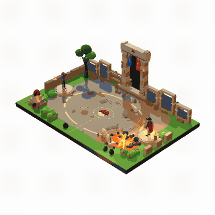
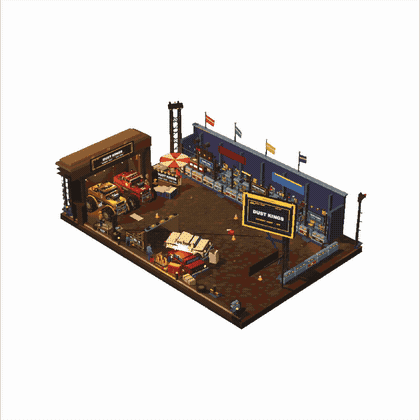
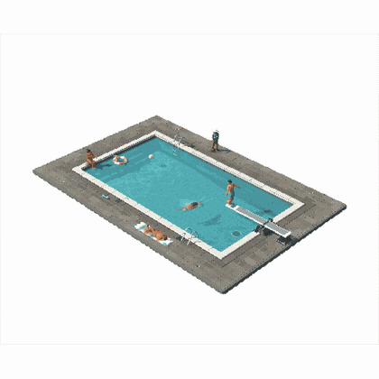
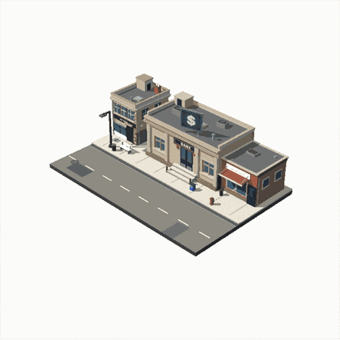
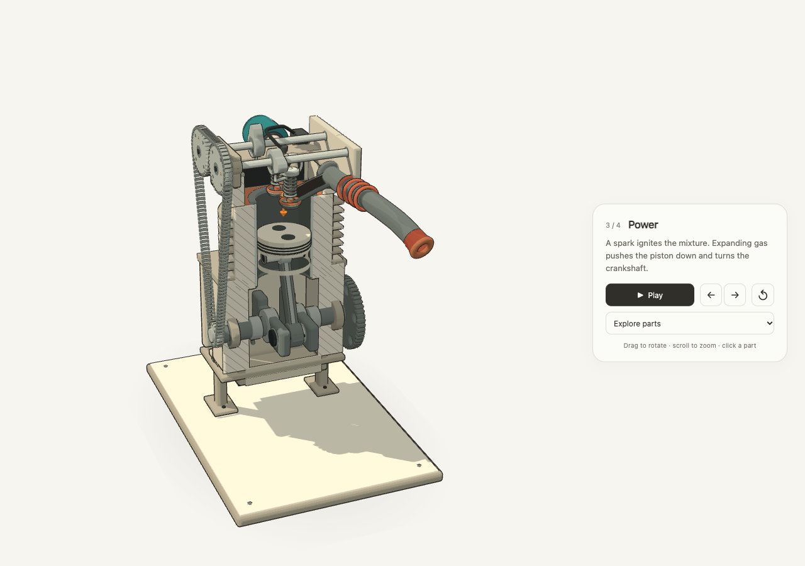
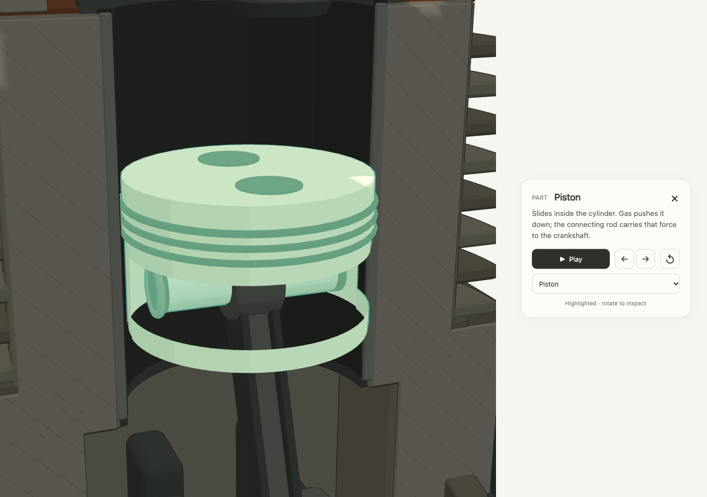

<div align="center">

# Diorama

**A playbook and code kit for detailed Three.js dioramas. It asks two questions before the first mesh: which of three looks to build in, and whether the models come from libraries or from your own geometry.**

[](https://github.com/sloemo01/diorama/stargazers)
[](https://github.com/sloemo01/diorama/forks)
[](https://github.com/sloemo01/diorama/watchers)
[](LICENSE)
[](SKILL.md)
[](https://threejs.org)

<p>
<a href="media/pikachu-vs-charizard.mp4"></a>
<a href="media/dust-kings.mp4"></a>
<a href="media/pool.mp4"></a>
<a href="media/bank-job.mp4"></a>
</p>

<sub><b>Pikachu vs Charizard</b>, 45 s &nbsp;·&nbsp; <b>Dust Kings</b>, 38 s &nbsp;·&nbsp; <b>Pool</b>, 26 s &nbsp;·&nbsp; <b>Bank job</b>, 48 s</sub>

<sub>Four scenes built with this playbook. Click any tile for the full capture.</sub>

[**Install it in one prompt**](#install-it) &nbsp;·&nbsp; [**Update it in one prompt**](#update-it) &nbsp;·&nbsp; [What is in here](#what-is-in-here) &nbsp;·&nbsp; [Start a diorama](#start-a-diorama) &nbsp;·&nbsp; [Verification](#verification)

</div>

A diorama here is a tiny staged scene on a slab: a resettable three-quarter hero camera with free user orbit, a
flat cut-out against white paper, a 64 colour palette with ordered dither and an
inked contour, and toy-scale people with real joint animation. The subject changes
(pool, night market, bank job, arena battle); the slab, the cast and the
presentation stay for the default pixel preset.

**Looks:** pixel (default), stroked toon, or pixel + stroke. The agent asks once and
builds in the answer; silence means pixel.

**Sourcing:** hybrid is the default: licensed assets, hand-built gaps. Also internet
throughout or agent-modelled. Assets must allow commercial use and redistribution,
with evidence in `refs/SOURCES.md` and `CREDITS.md`.

Everything is deterministic. The scene is a pure function of `t`, so any frame can
be frozen, screenshotted and compared. A screenshot is evidence, not a lucky
capture.

`SKILL.md` is the playbook: research-first workflow, the look and animation bars,
the pipeline, the recipes, the QA harness and the pitfalls. It stays the source of
truth. `references/` holds the same material split into on-demand topic files for
long sessions, and everything else here is copy-in code that supports it.

## Install it

Paste this into an agent that can run shell commands. It asks where to put the
folder, downloads the whole repository (playbook, templates, QA harness and every
worked example), reads them, and reports what it learned before it builds
anything. `SKILL.md` carries skill frontmatter (`name`, `description`, `version`),
so an agent with a skills directory can load it by name later.

```text
Install the Diorama playbook here, then use it to build scenes.

Repo: https://github.com/sloemo01/diorama

1. Ask me where the folder should go before downloading anything,
   and wait for my answer. Propose ~/skills/diorama as the default.
   Do not pick a path silently.
2. Download the whole repository, not just SKILL.md:
     git clone https://github.com/sloemo01/diorama.git "<target>"
   Without git:
     curl -L -o diorama.tar.gz \
       https://github.com/sloemo01/diorama/archive/main.tar.gz
     tar xzf diorama.tar.gz && mv diorama-main "<target>"
3. Prove the install before describing it: SKILL.md, README.md,
   references/, templates/, verify/ and LICENSE at the root, and print the
   commit hash (git -C "<target>" rev-parse --short HEAD) or the
   archive date. If you have no shell or no network, say so and
   stop. If the download failed or a file is missing, say so and
   stop. Never describe this playbook from memory.
4. If you have a skills directory or plugin folder, install it
   there so you can load it by name in later sessions; otherwise
   treat "<target>" as the folder.
5. Read before you build: all of SKILL.md, references/INDEX.md, then
   templates/DESIGN.md, templates/SOURCES.md, templates/CREDITS.md,
   templates/qa/README.md, the header comment of every file in
   templates/, and the worked examples under verify/. SKILL.md is
   the source of truth; the README is only a summary.
6. Report back in this order: install path and commit, the Look
   Contract in one paragraph, the Pipeline as ordered steps, the
   QA scripts and what each one checks, and three rules from
   SKILL.md with the section each came from.
7. Then ask me what the first diorama should be. Do not ask me to
   fill the design sheet. When I give you a subject, research it
   first (frames, assets, motion), fill DESIGN.md from the
   defaults, copy the modules you need into my project instead of
   editing the installed copy, build through the Pipeline, and run
   the QA scripts before you show me anything. Give me the paths
   of the frames you kept and what each one proves.

If two parts of SKILL.md contradict each other, list them before
you build. A successful clone is not an install: 5 and 6 are it.
```

### Update it

One prompt, for a copy that is already installed. It saves your local patch, pulls
the newest `main`, and reports what changed before any project is touched.

```text
Update my Diorama install, then report what changed.

Repo: https://github.com/sloemo01/diorama

1. Ask me for the folder before touching anything, and wait.
   Propose ~/skills/diorama as the default.
2. Print the current commit, then make the update reversible:
     git -C "<target>" rev-parse --short HEAD
     git -C "<target>" diff > my-changes.patch
     cp -R "<target>" "<target>.bak"
   The copy works without git. Keep both until I say the update is good.
3. Pull the latest main:
     git -C "<target>" fetch origin
     git -C "<target>" reset --hard origin/main
   Without git: download main.tar.gz, unpack it, and copy the
   contents over the old folder.
4. Prove it before describing it: print the old and new commit, the
   version line from SKILL.md frontmatter, and confirm SKILL.md,
   README.md, references/, templates/, verify/ and LICENSE are
   present. If the pull failed, say so and stop.
5. Report the difference in this order: version jump, new or removed
   folders and templates, rules that changed, and whether my saved
   patch still applies. Re-apply it only when it does, and say so when
   it does not.
6. If one of my dioramas is mid-build, read SKILL.md and
   references/INDEX.md again and list the rules that now affect that
   project. Do not rewrite the scene without asking me.
```

Both prompts need `git`, or `curl` and `tar` for the fallback. The QA scripts need
Node with `three`, `esbuild` and `playwright-core`. The `media/` previews are about
20 MB and can be deleted after the clone.

## Educational scenes and inspection (5.7)

Educational mode is a first-class exception to narrative cast/ritual/system quotas:
one accurately built mechanism, one causal sequence and clean off-white (`#f7f7f5`).
The default surface is one opaque white card in a reserved 360px right column, which
becomes a bottom dock below 880px; an explicitly requested placement keeps those tokens
and controls. Narrative scenes get none of it: no card, lesson steps, part picker,
dashboard or floating labels unless an explanation was asked for. Click a real part for
one short explanation, and the same labelled picker supports keyboard selection,
including pieces hidden inside the housing. Selection lifts the chosen material while
the rest dims, from reversible overrides that restore the exact original materials, and
feature edges are built from `EdgesGeometry` on the live meshes rather than a wireframe
pass. Selecting a part triggers one short camera and target transition, cancelled
immediately by user orbit or keyboard navigation; Back restores the previous view and
Reset keeps the hero pose. Component manifests, real through-bores and
ratio/kinematic/contact tests stop simplification from quietly deleting working parts.
Delivery needs frozen-frame, motion, orbit, mobile and accessibility evidence, not a
promise that an agent complied.

All presets rotate by default, with no separate orbit consent. `templates/orbit.js` supplies reset, keyboard orbit and drag-versus-click handling. `pixel-stroke` is chosen through that same one-question gate; `templates/pixel-stroke.js` renders toon materials and selective geometry contours into an explicit low-res target then nearest upscales once. No PixelPost/Sobel double edges; DOM UI stays native resolution. Stroke thickness must be checked in target pixels and after screen upscale.

## Motion graphics

Arrows, flames and flow are geometry, not texture. The v3.12.0 four-stroke work hardened them with a
full-cycle, frame-by-frame pass: a spline through the
cutaway speared the valve disc, only the arrow *centre* was clamped so heads
poked through the crown, two stacked rows read as double-headed chevrons, scales
ran past 1.0 and defeated the legibility gate, the force arrow outlived its
flame, and the ignition flash blew the head to white. The rules are: derive each
effect from the current free volume (never a port centreline), fit the
direction-dependent cone extent, anchor to the real valve/crown surface, use one
arrow per stroke, normalize the authored length, couple the effect to its source,
declare every Y constant in one local space, cap the flash, and accept only after
a 15°-step contact sheet plus a 720° vertex containment sweep. Earlier findings
still apply: tested +Z axis, no `depthTest:false`, no sub-pixel specks,
free-band sizing, compact flames, un-outlined FX and phase-bound lifetimes.
`templates/flow-primitives.js` is the copy-in helper: tested +Z arrows, a
free-band fitter and a legibility gate. See "Motion Graphics Primitives" in
`SKILL.md` and the effects block in `templates/DESIGN.md`.

<p align="center">


</p>

## The scenes

**Pikachu vs Charizard** is the fight at the top of this page: Leon throws a ball,
Charizard bursts out of it and the ball comes back to his hand, four attacks trade
across the arena with their own wind-up and hit reactions, Pikachu takes a
knockdown, and the red recall beam only appears once Charizard is beaten.

**Dust Kings** follows one night's billing: cars on the arena floor, the billboard
running through LIVE, NEW RECORD and THANK YOU, and a fire that gets away from
them.

**Pool** is a slow afternoon: one swimmer working laps with a wake trailing behind,
one standing waist-deep by the ladder, one folding into a dive beside the board, a
lifebuoy and a ball left floating, a lifeguard pacing the far edge, and a
sunbather who does not move from the towel.

**Bank job** runs in daylight: a sedan noses into the curb, a group in dark clothes
climbs the bank steps and the windows go red behind them, the sedan pulls away, two
cruisers arrive and officers fan out across the street, then the street empties
again.

## What is in here

| Path | What it is |
| --- | --- |
| `SKILL.md` | The whole playbook: research gate, look contract, detail and animation bars, pipeline, recipes, QA, pitfalls. Start here. |
| `templates/` | Copy-in modules: palette, post pass, camera, lighting, geometry, props, rig, poses, vehicle transfer, paths, combat, creature, water, effects, build script. |
| `templates/flow-primitives.js` | Tested +Z arrow primitive, free-band fitter and legibility gate for motion graphics. |
| `templates/DESIGN.md` | The design sheet you fill before modelling. |
| `templates/SOURCES.md` | The research log you fill before modelling: query, what was found, decision. |
| `templates/CREDITS.md` | The licence ledger for every imported model, clip or texture. |
| `templates/creature.js` | Rigged-actor combat: stage-local aiming, bone-space effect anchors, upright billboards, hit severities, send-out geometry. |
| `references/` | The playbook split by topic, indexed in `references/INDEX.md`: sourcing, representation, inspection, construction gates, service, vehicles, effects, verification. |
| `templates/qa/` | Eight verification scripts that check a build against frozen frames and printed numbers, including a per-entity frame recorder, plus unit and browser regressions for the inspection and mechanism helpers. |
| `archive/` | Retired material kept for reference: the removed Pixel Art V2 renderer and its supporting parts. |
| `verify/water/` | A worked scene that exercises the water modules, with the screenshots the QA loop produced. |
| `verify/climb/` | A unit test for the vehicle transfer maths. |
| `verify/creature-battle/` | What a two-actor fight build proved: aiming, effect anchoring, send-out and hit numbers. |
| `media/` | The preview GIFs and source captures shown above. |

## Start a diorama

1. Read `SKILL.md`: `Research Before You Model`, `One Prompt, One Build`, `The Look
   Contract`, `The Detail Bar`, `The Animation Bar`, `Pipeline`.
2. Research first. Step the real subject into frames and write its motion grammar
   down. Walk the sourcing ladder for every hero asset (already on disk, CC0,
   CC-BY, then hand-build) and record each search in `refs/SOURCES.md`. Imported
   assets get a row in `CREDITS.md`.
3. Copy `templates/DESIGN.md` into the project as `DESIGN.md` and fill it. Premise
   as a verb, cast, systems, five beats with timestamps, detail budget.
4. Copy the modules you need into `src/core/` and `src/scene/`, then a `config.js`
   that holds the scene's numbers. `verify/water/src/` is the reference layout.
5. Block out in grey at the reset hero camera before any production pass, then run the
   pipeline: palette, materials, detail, animation, effects, post.
6. Verify with `templates/qa/` before calling it done, and check the research gate
   in `Build And Ship` (reference sheets, `SOURCES.md`, `CREDITS.md`, per-beat
   captures).

## Research before you model

The playbook opens with four lookups, because a plausible silhouette that matches
nothing is the most common way a commission fails:

- **Shape.** Pull the real thing on video, step it into contact sheets at 8 to 12
  fps, read them, and write the grammar down before touching geometry.
- **Assets.** Check the user's disk, then the Polyfork catalogue, then the CC0 and CC-BY libraries (Quaternius,
  KayKit, Poly Pizza, Kenney, Sketchfab with the downloadable plus CC0 filter,
  Smithsonian, Poly Haven, ambientCG, Mixamo and the Quaternius animation
  library). A rigged download beats four hundred lines of primitives at close
  range. Licences that are NC, ND, ripped or unstated are a hard stop.
- **Motion.** Search the verb, not the noun. Count frames at a known fps, convert
  to seconds, and write wind-up / contact / follow-through / recover before
  animating.
- **Proof.** Freeze every beat and compare the capture against the reference
  frame for that beat.

`templates/SOURCES.md` and `templates/CREDITS.md` are the two artifacts that make
that research visible in a project, and `Build And Ship` will not pass without
them.

## How it works

- **One camera solve.** The camera is fitted to the slab's bounding box once, at a
  fixed three-quarter azimuth, with a `subjectScale` margin. Free orbit controls and reset in every preset; no auto-spin.
- **Two passes, one look.** The render is drawn into a small buffer, then gamma,
  grade, a 64 entry palette snap, ordered dither, an ink contour and a nearest
  neighbour upscale happen in that fixed order.
- **Detail is a bar, not a mood.** Every hero prop carries a real silhouette,
  chamfers, seams, hardware and a contact shadow; if it reads at a glance and
  still holds at 1:1, it passes.
- **Animation is five layers.** Idle, locomotion, secondary motion (clothes, hair,
  tails, capes), glance and weight shifts, then the scripted acting on top.
- **Everything is a function of `t`.** Actors, props, effects and camera are
  evaluated from the beat sheet each frame, so `?t=12.4` is exactly the same
  picture every time.

## Verification

The `templates/qa/` scripts drive Chromium through `playwright-core` against a
page that exposes a debug handle:

```js
window.__diorama = {
  THREE, scene, camera, renderer, post,
  freeze(t) { /* draw(t) synchronously */ },
  view(pos, tgt) { /* optional debug camera */ }
};
window.__dioramaReady = true;
```

| Script | What it checks |
| --- | --- |
| `shoot.mjs` | console errors, layout at each viewport, named frozen timestamps |
| `audit.mjs` | flat glows, whole-group fades, early hides, teleports, margin leaks |
| `portrait.mjs` | isolated figures through a debug camera |
| `strip.mjs` | N-frame motion strips, fails on a frozen loop |
| `frames.mjs` | per-entity frame series with a verdict each: FROZEN, TELEPORT, EMPTY, OFFSCREEN |
| `sweep.mjs` | pairwise distances, jam and teleport verdicts |
| `probe.py` | colour runs across an edge |
| `tile.py` | tiles a motion strip into a contact sheet |

`freeze(t)` has to draw synchronously. Without it a screenshot is a race, and a
screenshot that may show a different frame than you asked for is not evidence.

`frames.mjs` is the one that pays for itself on a scene with more than two actors.
It records one dense series per entity, isolates it, fits a camera to its swept
bounds, and scores it: a flat energy line means the actor is not animating, an NDC
jump means a state boundary is snapping instead of blending, and empty frames mean
the window is wrong. Each entity gets a contact sheet and a verdict, so a dead
actor cannot hide behind a moving neighbour.

The worked examples under `verify/` show the loop end to end, including the
defects the harness found and the numbers after the fix.

## Using it as a skill

`SKILL.md` carries skill frontmatter (`name`, `description`, `version`), so a
skill-capable coding agent can load it as-is. It reads on its own; `references/`
carries the same guidance split by topic for long sessions, and `templates/` carries
the copy-in code.

If you just want to read it, start at `Research Before You Model`, then
`One Prompt, One Build` and `The Look Contract`.

Long builds will eventually compact the agent's context, and compaction is lossy.
`SKILL.md` has a `Long builds and context` section for that: state lives in
`DESIGN.md`, `SOURCES.md`, `CREDITS.md`, `report.json` and the beat table rather
than in the chat, and after a compact the agent re-runs `frames.mjs` and
`shoot.mjs` instead of trusting its own summary of the last frame.

## Licence

MIT. See `LICENSE`. three.js is MIT as well.
