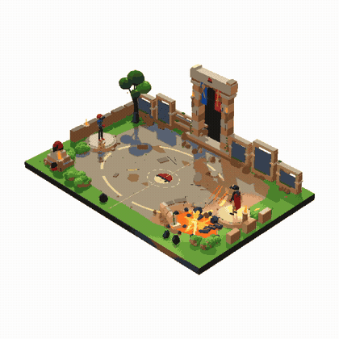

<div align="center">

# Diorama

**A playbook and code kit for building small pixel-art dioramas in Three.js.**

[](https://github.com/sloemo01/diorama/stargazers)
[](https://github.com/sloemo01/diorama/forks)
[](https://github.com/sloemo01/diorama/watchers)
[](LICENSE)
[](SKILL.md)
[](https://threejs.org)

<p>
<a href="media/pikachu-vs-charizard.mp4"></a>
<a href="media/dust-kings.mp4"></a>
<a href="media/pool.mp4"></a>
<a href="media/bank-job.mp4"></a>
</p>

<sub><b>Pikachu vs Charizard</b>, 45 s &nbsp;·&nbsp; <b>Dust Kings</b>, 38 s &nbsp;·&nbsp; <b>Pool</b>, 26 s &nbsp;·&nbsp; <b>Bank job</b>, 48 s</sub>

<sub>Four scenes built with this playbook. Click any tile for the full capture.</sub>

</div>

A diorama here is a tiny staged scene on a slab: a locked three-quarter camera, a
flat cut-out against white paper, a 64 colour palette with ordered dither and an
inked contour, and toy-scale people with real joint animation. The subject changes
(pool, night market, bank job, arena battle); the slab, the cast and the
presentation stay.

Everything is deterministic. The scene is a pure function of `t`, so any frame can
be frozen, screenshotted and compared. A screenshot is evidence, not a lucky
capture.

`SKILL.md` is the whole playbook: it carries a research-first workflow, the look
and animation bars, the pipeline, the recipes, the QA harness and the pitfalls,
in one self-contained file. Everything else here is copy-in code that supports it.

## The scenes

**Pikachu vs Charizard** is the fight at the top of this page: Leon throws a ball,
Charizard bursts out of it and the ball comes back to his hand, four attacks trade
across the arena with their own wind-up and hit reactions, Pikachu takes a
knockdown, and the red recall beam only appears once Charizard is beaten.

**Dust Kings** follows one night's billing: cars on the arena floor, the billboard
running through LIVE, NEW RECORD and THANK YOU, and a fire that gets away from
them.

**Pool** is a slow afternoon: one swimmer working laps with a wake trailing behind,
one standing waist-deep by the ladder, one folding into a dive beside the board, a
lifebuoy and a ball left floating, a lifeguard pacing the far edge, and a
sunbather who does not move from the towel.

**Bank job** runs in daylight: a sedan noses into the curb, a group in dark clothes
climbs the bank steps and the windows go red behind them, the sedan pulls away, two
cruisers arrive and officers fan out across the street, then the street empties
again.

## Install it

Paste this into an agent that can run shell commands. It asks where to put the
folder, downloads the whole repository (playbook, templates, QA harness and every
worked example), reads them, and reports what it learned before it builds
anything. `SKILL.md` carries skill frontmatter (`name`, `description`, `version`),
so an agent with a skills directory can load it by name later.

```text
Install the Diorama playbook here, then use it to build scenes.

Repo: https://github.com/sloemo01/diorama

1. Ask me where the folder should go before downloading anything,
   and wait for my answer. Propose ~/skills/diorama as the default.
   Do not pick a path silently.
2. Download the whole repository, not just SKILL.md:
     git clone https://github.com/sloemo01/diorama.git "<target>"
   Without git:
     curl -L -o diorama.tar.gz \
       https://github.com/sloemo01/diorama/archive/main.tar.gz
     tar xzf diorama.tar.gz && mv diorama-main "<target>"
3. Prove the install before describing it: SKILL.md, README.md,
   templates/, verify/ and LICENSE at the root, and print the
   commit hash (git -C "<target>" rev-parse --short HEAD) or the
   archive date. If you have no shell or no network, say so and
   stop. If the download failed or a file is missing, say so and
   stop. Never describe this playbook from memory.
4. If you have a skills directory or plugin folder, install it
   there so you can load it by name in later sessions; otherwise
   treat "<target>" as the folder.
5. Read before you build: all of SKILL.md, then
   templates/DESIGN.md, templates/SOURCES.md, templates/CREDITS.md,
   templates/qa/README.md, the header comment of every file in
   templates/, and the worked examples under verify/. SKILL.md is
   the source of truth; the README is only a summary.
6. Report back in this order: install path and commit, the Look
   Contract in one paragraph, the Pipeline as ordered steps, the
   QA scripts and what each one checks, and three rules from
   SKILL.md with the section each came from.
7. Then ask me what the first diorama should be. Do not ask me to
   fill the design sheet. When I give you a subject, research it
   first (frames, assets, motion), fill DESIGN.md from the
   defaults, copy the modules you need into my project instead of
   editing the installed copy, build through the Pipeline, and run
   the QA scripts before you show me anything. Give me the paths
   of the frames you kept and what each one proves.

If two parts of SKILL.md contradict each other, list them before
you build. A successful clone is not an install: 5 and 6 are it.
```

Needs `git`, or `curl` and `tar` for the fallback. The QA scripts need Node with
`three`, `esbuild` and `playwright-core`. The `media/` previews are about 20 MB
and can be deleted after the clone.

## What is in here

| Path | What it is |
| --- | --- |
| `SKILL.md` | The whole playbook: research gate, look contract, detail and animation bars, pipeline, recipes, QA, pitfalls. Start here. |
| `templates/` | Copy-in modules: palette, post pass, camera, lighting, geometry, props, rig, poses, vehicle transfer, paths, combat, creature, water, effects, build script. |
| `templates/DESIGN.md` | The design sheet you fill before modelling. |
| `templates/SOURCES.md` | The research log you fill before modelling: query, what was found, decision. |
| `templates/CREDITS.md` | The licence ledger for every imported model, clip or texture. |
| `templates/creature.js` | Rigged-actor combat: stage-local aiming, bone-space effect anchors, upright billboards, hit severities, send-out geometry. |
| `templates/qa/` | Eight verification scripts that check a build against frozen frames and printed numbers, including a per-entity frame recorder. |
| `verify/water/` | A worked scene that exercises the water modules, with the screenshots the QA loop produced. |
| `verify/climb/` | A unit test for the vehicle transfer maths. |
| `verify/creature-battle/` | What a two-actor fight build proved: aiming, effect anchoring, send-out and hit numbers. |
| `media/` | The preview GIFs and source captures shown above. |

## Start a diorama

1. Read `SKILL.md`: `Research Before You Model`, `One Prompt, One Build`, `The Look
   Contract`, `The Detail Bar`, `The Animation Bar`, `Pipeline`.
2. Research first. Step the real subject into frames and write its motion grammar
   down. Walk the sourcing ladder for every hero asset (already on disk, CC0,
   CC-BY, then hand-build) and record each search in `refs/SOURCES.md`. Imported
   assets get a row in `CREDITS.md`.
3. Copy `templates/DESIGN.md` into the project as `DESIGN.md` and fill it. Premise
   as a verb, cast, systems, five beats with timestamps, detail budget.
4. Copy the modules you need into `src/core/` and `src/scene/`, then a `config.js`
   that holds the scene's numbers. `verify/water/src/` is the reference layout.
5. Block out in grey at the locked camera before any production pass, then run the
   pipeline: palette, materials, detail, animation, effects, post.
6. Verify with `templates/qa/` before calling it done, and check the research gate
   in `Build And Ship` (reference sheets, `SOURCES.md`, `CREDITS.md`, per-beat
   captures).

## Research before you model

The playbook opens with four lookups, because a plausible silhouette that matches
nothing is the most common way a commission fails:

- **Shape.** Pull the real thing on video, step it into contact sheets at 8 to 12
  fps, read them, and write the grammar down before touching geometry.
- **Assets.** Check the user's disk, then the CC0 and CC-BY libraries (Quaternius,
  KayKit, Poly Pizza, Kenney, Sketchfab with the downloadable plus CC0 filter,
  Smithsonian, Poly Haven, ambientCG, Mixamo and the Quaternius animation
  library). A rigged download beats four hundred lines of primitives at close
  range. Licences that are NC, ND, ripped or unstated are a hard stop.
- **Motion.** Search the verb, not the noun. Count frames at a known fps, convert
  to seconds, and write wind-up / contact / follow-through / recover before
  animating.
- **Proof.** Freeze every beat and compare the capture against the reference
  frame for that beat.

`templates/SOURCES.md` and `templates/CREDITS.md` are the two artifacts that make
that research visible in a project, and `Build And Ship` will not pass without
them.

## How it works

- **One camera solve.** The camera is fitted to the slab's bounding box once, at a
  fixed three-quarter azimuth, with a `subjectScale` margin. No orbit controls.
- **Two passes, one look.** The render is drawn into a small buffer, then gamma,
  grade, a 64 entry palette snap, ordered dither, an ink contour and a nearest
  neighbour upscale happen in that fixed order.
- **Detail is a bar, not a mood.** Every hero prop carries a real silhouette,
  chamfers, seams, hardware and a contact shadow; if it reads at a glance and
  still holds at 1:1, it passes.
- **Animation is five layers.** Idle, locomotion, secondary motion (clothes, hair,
  tails, capes), glance and weight shifts, then the scripted acting on top.
- **Everything is a function of `t`.** Actors, props, effects and camera are
  evaluated from the beat sheet each frame, so `?t=12.4` is exactly the same
  picture every time.

## Verification

The `templates/qa/` scripts drive Chromium through `playwright-core` against a
page that exposes a debug handle:

```js
window.__diorama = {
  THREE, scene, camera, renderer, post,
  freeze(t) { /* draw(t) synchronously */ },
  view(pos, tgt) { /* optional debug camera */ }
};
window.__dioramaReady = true;
```

| Script | What it checks |
| --- | --- |
| `shoot.mjs` | console errors, layout at each viewport, named frozen timestamps |
| `audit.mjs` | flat glows, whole-group fades, early hides, teleports, margin leaks |
| `portrait.mjs` | isolated figures through a debug camera |
| `strip.mjs` | N-frame motion strips, fails on a frozen loop |
| `frames.mjs` | per-entity frame series with a verdict each: FROZEN, TELEPORT, EMPTY, OFFSCREEN |
| `sweep.mjs` | pairwise distances, jam and teleport verdicts |
| `probe.py` | colour runs across an edge |
| `tile.py` | tiles a motion strip into a contact sheet |

`freeze(t)` has to draw synchronously. Without it a screenshot is a race, and a
screenshot that may show a different frame than you asked for is not evidence.

`frames.mjs` is the one that pays for itself on a scene with more than two actors.
It records one dense series per entity, isolates it, fits a camera to its swept
bounds, and scores it: a flat energy line means the actor is not animating, an NDC
jump means a state boundary is snapping instead of blending, and empty frames mean
the window is wrong. Each entity gets a contact sheet and a verdict, so a dead
actor cannot hide behind a moving neighbour.

The worked examples under `verify/` show the loop end to end, including the
defects the harness found and the numbers after the fix.

## Using it as a skill

`SKILL.md` carries skill frontmatter (`name`, `description`, `version`), so a
skill-capable coding agent can load it as-is. It is self-contained: no external
reference documents, everything needed to build a diorama is in the file plus
`templates/`.

If you just want to read it, start at `Research Before You Model`, then
`One Prompt, One Build` and `The Look Contract`.

Long builds will eventually compact the agent's context, and compaction is lossy.
`SKILL.md` has a `Long builds and context` section for that: state lives in
`DESIGN.md`, `SOURCES.md`, `CREDITS.md`, `report.json` and the beat table rather
than in the chat, and after a compact the agent re-runs `frames.mjs` and
`shoot.mjs` instead of trusting its own summary of the last frame.

## Licence

MIT. See `LICENSE`. three.js is MIT as well.
