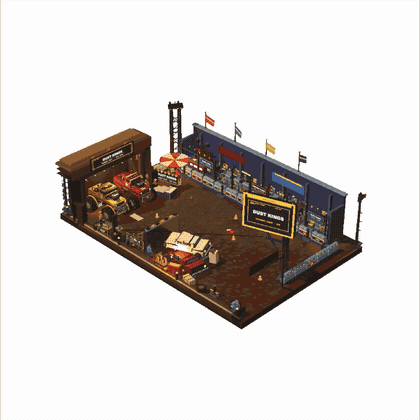
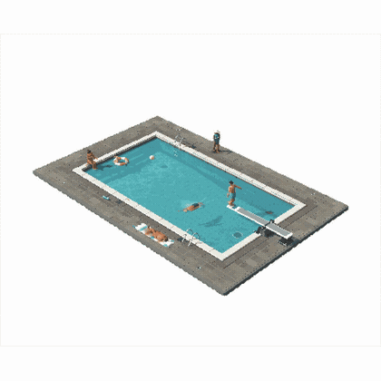
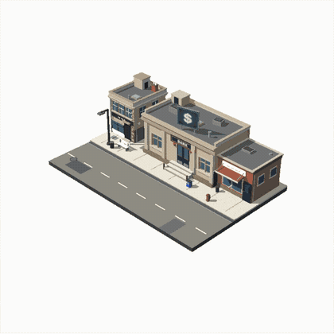

# Diorama

A playbook and code kit for building small pixel-art dioramas in Three.js.

A diorama here means a tiny staged scene on a slab: a locked three-quarter camera,
a flat cut-out against white paper, a 64-colour palette with ordered dither and an
inked contour, and toy-scale people with real joint animation. The subject changes
(pool, night market, bakery, harbour, bank job); the slab, the cast and the
presentation stay.

Everything is deterministic. The scene is a pure function of `t`, so any frame can
be frozen, screenshotted and compared.

## Preview

Three scenes built with this playbook. Each tile loops in place; click one to open
the full capture.

<p>
<a href="media/dust-kings.mp4"></a>
<a href="media/pool.mp4"></a>
<a href="media/bank-job.mp4"></a>
</p>

<sub><b>Dust Kings</b>, 38 s &nbsp;·&nbsp; <b>Pool</b>, 26 s &nbsp;·&nbsp; <b>Bank job</b>, 48 s</sub>

The Dust Kings loop follows one night's billing: cars on the arena floor, the
billboard running through LIVE, NEW RECORD and THANK YOU, and a fire that gets
away from them.

The pool loop is a slow afternoon: one swimmer working laps with a wake trailing
behind, one standing waist-deep by the ladder, one folding into a dive beside the
board, a lifebuoy and a ball left floating, a lifeguard pacing the far edge, and a
sunbather who does not move from the towel.

The bank job loop runs in daylight: a sedan noses into the curb, a group in dark
clothes climbs the bank steps and the windows go red behind them, the sedan pulls
away, two cruisers arrive and officers fan out across the street, and then the
street empties again.

## What is in here

| Path | What it is |
| --- | --- |
| `SKILL.md` | The whole playbook: look contract, detail and animation bars, pipeline, recipes, QA and pitfalls. Start here. |
| `templates/` | Copy-in modules: palette, post pass, camera, lighting, geometry, props, rig, poses, vehicle transfer, paths, combat, water, effects, build script. |
| `templates/DESIGN.md` | The design sheet you fill before modelling. |
| `templates/qa/` | Seven verification scripts that check a build against frozen frames and printed numbers. |
| `verify/water/` | A worked scene that exercises the water modules, with the screenshots the QA loop produced. |
| `verify/climb/` | A unit test for the vehicle transfer maths. |
| `media/` | The preview GIFs and source captures shown above. |

## Install it

Paste this into an agent that can run shell commands. It asks where to put the
folder, downloads the whole repository (playbook, templates, QA harness and both
worked examples), reads them, and reports what it learned before it builds
anything. `SKILL.md` carries skill frontmatter (`name`, `description`, `version`),
so an agent with a skills directory can load it by name later.

```text
Install the Diorama playbook into this environment, then use it to build scenes.

Repository: https://github.com/sloemo01/diorama

1. Ask me for the target directory before downloading anything, and wait for my
   answer. Propose ~/skills/diorama as the default. Do not pick a path silently.
2. Download the whole repository, not just SKILL.md:
     git clone https://github.com/sloemo01/diorama.git "<target>"
   If git is not available:
     curl -L https://github.com/sloemo01/diorama/archive/refs/heads/main.tar.gz | tar xz
   then move diorama-main to "<target>".
3. Prove the install before describing it: SKILL.md, README.md, templates/,
   verify/ and LICENSE present at the root, and print the commit hash
   (git -C "<target>" rev-parse --short HEAD) or the archive date. If the
   download failed or a file is missing, say so and stop. Never describe this
   playbook from memory or from this prompt alone.
4. If you have a skills directory or plugin folder, install it there so you can
   load it by name in later sessions; otherwise treat "<target>" as the folder.
5. Read before you build: all of SKILL.md, then templates/DESIGN.md,
   templates/qa/README.md, the header comment of every file in templates/, and
   both worked examples under verify/. SKILL.md is the source of truth; the
   README is only a summary.
6. Report back in this order: install path and commit, the Look Contract in one
   paragraph, the Pipeline as ordered steps, the QA scripts and what each one
   checks, and three rules from SKILL.md with the section each came from.
7. Then ask me what the first diorama should be. Do not ask me to fill the design
   sheet. When I give you a subject, fill DESIGN.md from the defaults, copy the
   modules you need into my project instead of editing the installed copy, build
   through the Pipeline, and run the QA scripts before you show me anything. Give
   me the paths of the frames you kept and what each one proves.

If two parts of SKILL.md contradict each other, list the contradictions before
you build. A successful clone is not an install: steps 5 and 6 are the install.
```

Needs `git`, or `curl` and `tar` for the fallback. The QA scripts need Node with
`three`, `esbuild` and `playwright-core`. The `media/` previews are about 18 MB
and can be deleted after the clone.

## Start a diorama

1. Read `SKILL.md`: `One Prompt, One Build`, `The Look Contract`, `The Detail Bar`,
   `The Animation Bar`, `Pipeline`.
2. Copy `templates/DESIGN.md` into the project as `DESIGN.md` and fill it. Premise
   as a verb, cast, systems, five beats with timestamps, detail budget.
3. Copy the modules you need into `src/core/` and `src/scene/`, then a `config.js`
   that holds the scene's numbers. `verify/water/src/` is the reference layout.
4. Block out in grey at the locked camera before any production pass, then run the
   pipeline: palette, materials, detail, animation, effects, post.
5. Verify with `templates/qa/` before calling it done.

The QA scripts drive Chromium through `playwright-core` and expect the page to
expose a debug handle:

```js
window.__diorama = {
  THREE, scene, camera, renderer, post,
  freeze(t) { /* draw(t) synchronously */ },
  view(pos, tgt) { /* optional debug camera */ }
};
window.__dioramaReady = true;
```

`freeze(t)` has to draw synchronously. Without it a screenshot is a race, and a
screenshot that may show a different frame than you asked for is not evidence.

`verify/water/` and `verify/climb/` show the full loop end to end.

## Licence

MIT. See `LICENSE`.
